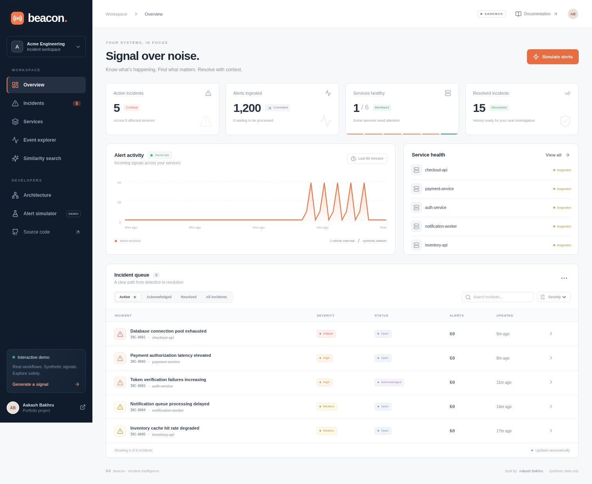
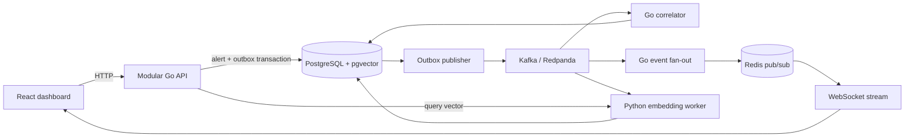

<div align="center">


# Beacon

### Signal over noise.

A real-time incident intelligence platform that turns infrastructure alerts into focused incidents, live timelines, and searchable failure history.

[**Explore the interactive demo →**](https://atbakhru.github.io/beacon/) · [Architecture](docs/architecture.md) · [API contract](packages/contracts/openapi.json) · [Validation evidence](docs/evidence/README.md)


</div>



## The problem

An outage can generate hundreds of alerts before an engineer has enough context to act. Beacon groups related signals by tenant, service, failure signature, and time window; tracks investigation and recovery; and retrieves similar previous failures. Every fixture is synthetic.

## Try it in two minutes

1. Open the [demo](https://atbakhru.github.io/beacon/).
2. Select **Simulate alerts**, choose a failure, and send 1,000 alerts.
3. Open the incident, acknowledge it, assign a team, and resolve it.
4. Inspect the timeline and previous matching incidents.
5. Run **Test duplicate protection** to see an identical source event accepted once.

The public demo runs locally in your browser and persists changes in localStorage. It uses keyword/signature matching. The full backend below uses PostgreSQL, Kafka, Redis, and a Python vector worker. The demo intentionally does not pretend to be a cloud deployment of that stack.

## Run the full stack

Prerequisites: Docker with Compose, Python 3.10+ for the seed script; allow around 6 GB of free space for images (more with Docker's `vfs` storage driver).

```bash
git clone https://github.com/atbakhru/beacon.git
cd beacon
make up
make seed-demo
# Dashboard: http://localhost:8088
# API health: http://localhost:8080/healthz
make smoke
```

`make up` launches PostgreSQL 16 + pgvector, Redis 7, Kafka-compatible Redpanda, the Go API and consumers, the Python embedding worker, and the Nginx-hosted React app. The API applies the idempotent initial migration and creates six demo services. The seed script submits 1,200 stable event IDs, waits for correlation, and resolves historical fixtures. Re-running it does not duplicate alerts.

For a frontend-only development session:

```bash
make demo  # http://localhost:5173; no cloud or Docker required
```

For backend development, start only the dependencies with `docker compose -f infra/docker/compose.yml up -d postgres redis kafka`, run `DEMO_MODE=true go run ./cmd/beacon`, and run the Python worker with the environment in `.env.example`.

## What is implemented

- **Durable ingestion:** alerts and outbox rows commit together. Unique tenant/source event keys make retries safe.
- **Concurrent correlation:** a transaction and advisory lock serialize each tenant/service/signature group; duplicate Kafka delivery cannot increment counts twice. Rules configure grouping windows.
- **Incident workflows:** acknowledgement, resolution, reopening, ownership, timelines, and raw alert inspection.
- **Live updates:** Kafka incident events fan out through Redis to WebSockets. Each client has a 256-message queue; reconnect reloads authoritative state. Durable timeline/event cursor APIs support recovery.
- **Vector retrieval:** a Python worker indexes versioned 384-dimensional vectors, reacts to Kafka, and backfills missed versions. pgvector applies tenant scope and model-version filtering.
- **Dashboard:** six views, responsive layout, URL-persisted filters, a scenario simulator, and a persistent browser demo.
- **27 REST routes** (including health and telemetry) plus WebSocket; [OpenAPI 3](packages/contracts/openapi.json).
- **Verification:** Go race-enabled unit/integration tests, browser journeys, full-pipeline smoke checks, and a reproducible HTTP benchmark.

## Learned semantic embeddings

The small default image uses **signed feature hashing**, a deterministic lexical vector baseline. Enable the learned MiniLM model for semantic similarity:

```bash
SEMANTIC=true MODEL_NAME=sentence-transformers/all-MiniLM-L6-v2 \
  docker compose -f infra/docker/compose.yml up -d --build embeddings
```

The first start downloads an ONNX model. Indexing and query encoding always use the same model version. The worker backfills records when the model changes; search excludes incompatible vectors. Exact tenant-filtered cosine ranking is used for the small fixture; the migration also defines an HNSW index for later scale experiments.

## Architecture



This is one modular Go deployable with six responsibility boundaries, plus a Python worker. It does **not** claim six independently deployed microservices. See [decisions, guarantees, and tradeoffs](docs/architecture.md).

## Validation

```bash
make test                 # Go race tests + TypeScript/production build
make test-integration     # isolated schemas in local PostgreSQL
make smoke                # actual Kafka/Redis/worker path, after make up
make benchmark            # 10/50/100 concurrent HTTP readers
cd apps/web
npx playwright install chromium
npm run test:e2e          # browser demo journeys
```

See [recorded results and conditions](docs/evidence/README.md). Benchmark numbers are observations for a small loopback workload, not production SLOs. No sub-10ms semantic-search or AWS deployment claim is made.

## Deployment and security boundaries

[GitHub Pages](.github/workflows/pages.yml) publishes the self-contained synthetic demo. [Terraform](infra/terraform/) defines an optional AWS ECS/RDS/Redis/MSK deployment for the backend and includes a deployment runbook. It has not been applied to an AWS account. No paid infrastructure is required to try this project.

Docker binds ports to loopback. `DEMO_MODE=true` deliberately grants access to a single synthetic tenant. With demo mode disabled, `API_KEYS_JSON` maps bearer keys to server-controlled tenant IDs; client-provided tenant headers are ignored. The API has origin checks, input limits, request IDs, parameterized queries, tenant filters, and non-root application containers. Production OIDC, browser session authentication, admission rate limits, poison-event quarantine, and operational alerting remain hardening work. Do not expose the local demo configuration to real customer data.

## Repository map

```text
apps/web/                React + TypeScript UI, browser adapter, Playwright tests
cmd/beacon/              Go executable and lifecycle
internal/beacon/         HTTP, domain, PostgreSQL store, Kafka pipeline, tests
workers/embeddings/      Python vector worker and query encoder
db/migrations/          Versioned SQL schema and indexes
packages/contracts/     OpenAPI and event schema
infra/docker/           Local Compose and container builds
infra/terraform/        Optional AWS deployment definition
scripts/                Seed, smoke test, benchmark
.github/workflows/      CI and public demo deployment
docs/                   Architecture, runbooks, measured evidence
```

Built by [Aakash Bakhru](https://github.com/atbakhru). [MIT licensed](LICENSE).
